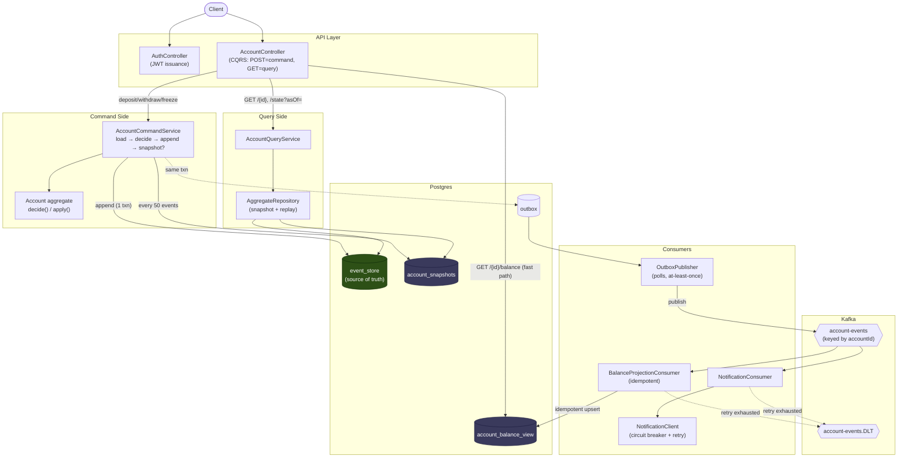
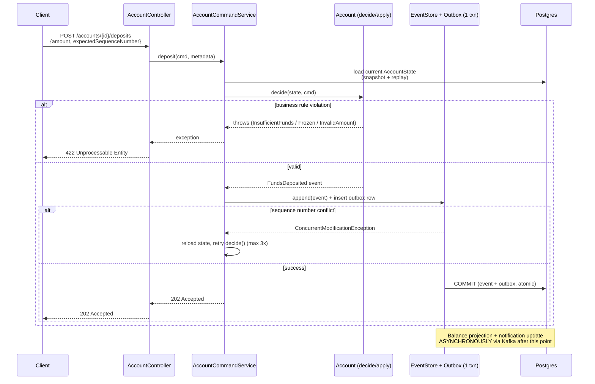
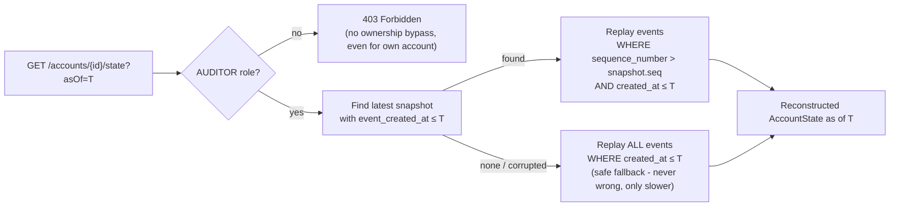
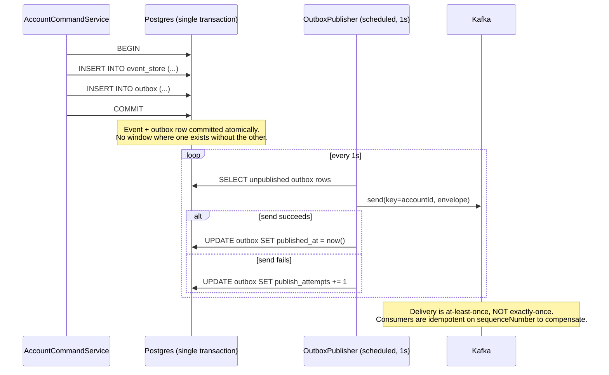

# Event-Sourced Banking Ledger with Time-Travel Queries

A backend project demonstrating **event sourcing**, **CQRS**, **Kafka + outbox
pattern**, **snapshotting**, **JWT/RBAC security with object-level authorization**,
**Resilience4j fault tolerance**, and **Micrometer/Prometheus observability** —
built around a banking-style account ledger.

Built in Java 17 / Spring Boot 3.3, incrementally, one capability at a time — see
the commit history for the real build order.

---

## Why this project exists

Most "banking" portfolio projects are CRUD with a balance column. This one is
built the way a ledger that has to survive an audit actually needs to be built:
**every mutation is an immutable fact**, current state is *derived*, and you can
ask the system "what did this account look like at 3:47pm last Tuesday?" and get
a provably correct answer.

---

## Architecture



**The one sentence that matters:** `event_store` is the only source of truth;
`account_balance_view` and `account_snapshots` are disposable, rebuildable caches
that exist purely for read performance.

---

## Command flow (writing a deposit)



---

## Time-travel query



---

## Outbox pattern (solving the dual-write problem)



---

## Security model

```mermaid
flowchart TD
    Req["Incoming request + Bearer JWT"] --> Filter["JwtAuthenticationFilter<br/>validates signature, issuer, expiry"]
    Filter --> URL{"URL-level RBAC<br/>(SecurityConfig)"}
    URL -->|role insufficient| F403["403"]
    URL -->|role OK| Obj{"Object-level check<br/>(AccountAccessGuard)"}
    Obj -->|"CUSTOMER: owns this account?"| Owns{owns?}
    Obj -->|"TELLER/ADMIN: bypass"| Allow["Allowed"]
    Owns -->|no| F403b["403 - stops IDOR:<br/>can't read another customer's<br/>account by changing the URL"]
    Owns -->|yes| Allow
    Allow --> Handler["Controller method executes"]

    style F403 fill:#5c1a1a
    style F403b fill:#5c1a1a
    style Allow fill:#1a4d1a
```



Time-travel (`/state?asOf=`) requires `AUDITOR` — not even the account's own
customer gets it.

---

## What's built

| Capability | Details |
|---|---|
| Event sourcing | `Account.decide()`/`apply()` split — commands can be rejected, events cannot |
| Optimistic concurrency | `UNIQUE(aggregate_id, sequence_number)` at the DB level, with reload-and-retry |
| Time-travel queries | Reconstruct exact historical state as of any timestamp |
| Kafka + outbox pattern | Solves the dual-write problem; idempotent balance projection |
| Snapshotting | Every 50 events, with safe fallback to full replay if missing/corrupted |
| Security | JWT + RBAC (`CUSTOMER`/`TELLER`/`AUDITOR`/`ADMIN`) + object-level authorization (IDOR protection) |
| Resilience | Circuit breaker + retry + timeout on external calls, Kafka dead-letter handling |
| Observability | Micrometer metrics, Actuator health/readiness probes, Prometheus + Grafana |

## Tech stack

Java 17 · Spring Boot 3.3 · Spring Security · Spring Kafka · PostgreSQL · Flyway ·
Resilience4j · Micrometer / Prometheus / Grafana · Testcontainers · JUnit 5 · Docker Compose

---

## Running it

```bash
docker compose up -d
# Postgres:5432 · Kafka:29092(host) · Kafka UI: http://localhost:8081
# Prometheus: http://localhost:9090 · Grafana: http://localhost:3000 (admin/admin)
# App: http://localhost:8080
```

```bash
# 1. Get a demo JWT for a customer
TOKEN=$(curl -s -X POST localhost:8080/api/v1/auth/demo-login \
  -H "Content-Type: application/json" \
  -d '{"username":"alice","role":"CUSTOMER","customerId":"11111111-1111-1111-1111-111111111111"}' \
  | python3 -c "import sys,json; print(json.load(sys.stdin)['accessToken'])")

# 2. Open an account
curl -X POST localhost:8080/api/v1/accounts \
  -H "Authorization: Bearer $TOKEN" -H "Content-Type: application/json" \
  -d '{"customerId":"11111111-1111-1111-1111-111111111111","currency":"INR"}'

# 3. Deposit
curl -X POST localhost:8080/api/v1/accounts/{id}/deposits \
  -H "Authorization: Bearer $TOKEN" -H "Content-Type: application/json" \
  -d '{"amount":500.00,"referenceId":"txn-1","expectedSequenceNumber":1}'

# 4. Fast-path balance
curl -H "Authorization: Bearer $TOKEN" localhost:8080/api/v1/accounts/{id}/balance

# 5. Time travel — requires an AUDITOR token
AUDITOR_TOKEN=$(curl -s -X POST localhost:8080/api/v1/auth/demo-login \
  -H "Content-Type: application/json" -d '{"username":"carol","role":"AUDITOR"}' \
  | python3 -c "import sys,json; print(json.load(sys.stdin)['accessToken'])")
curl -H "Authorization: Bearer $AUDITOR_TOKEN" \
  "localhost:8080/api/v1/accounts/{id}/state?asOf=2026-09-01T00:00:00Z"
```

### Tests

```bash
./mvnw test                                    # unit tests
./mvnw test -Dtest=EventStoreConcurrencyIT      # concurrency proof, needs Docker
```

---

## Roadmap

- Multi-account `TransferFunds` saga with compensation on partial failure
- Event schema versioning / upcasting for long-lived event contracts
- JMeter load-test report comparing replay latency with and without snapshots
- Cryptographic hash-chaining for tamper-evident audit trails

---

## Author

**Siddharth Tiwari**

- Portfolio: [siddharth-tiwari.vercel.app](https://siddharth-tiwari.vercel.app/)
- LinkedIn: [in/siddharth-tiwari-394451271](https://www.linkedin.com/in/siddharth-tiwari-394451271/)
- GitHub: [@Sidd-Tiwari](https://github.com/Sidd-Tiwari)
- LeetCode: [Sidd-Tiwari](https://leetcode.com/u/Sidd-Tiwari/)

If you found this project useful or interesting, consider giving it a ⭐ on GitHub.

## License

MIT — see [LICENSE](LICENSE).
