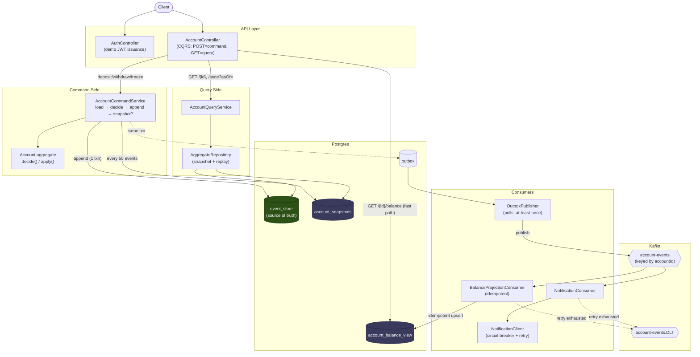
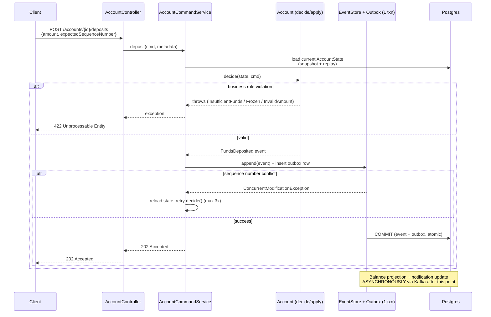
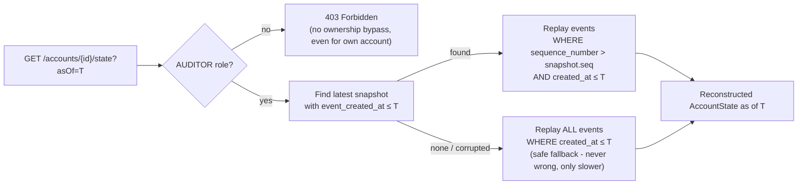
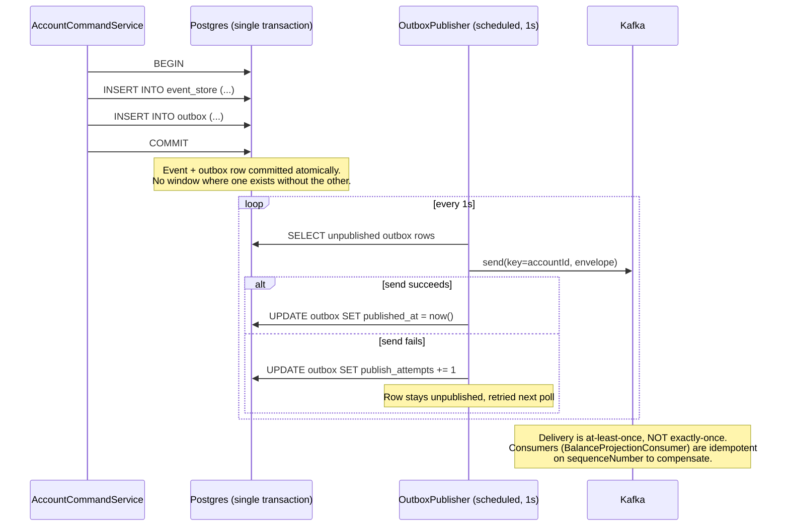

# Event-Sourced Ledger with Time-Travel Queries

A portfolio backend project demonstrating **event sourcing**, **CQRS**, **Kafka +
outbox pattern**, **snapshotting**, **JWT/RBAC security with object-level
authorization**, **Resilience4j fault tolerance**, and **Micrometer/Prometheus
observability** — built around a banking-style account ledger.

> Built in Java 17 / Spring Boot 3.3, incrementally, phase by phase — see the
> [commit history](#commit-history--how-this-was-built) for the real build order.

---

## Why this project exists

Most portfolio "banking" projects are CRUD with a balance column. This one is built
the way a ledger that has to survive an audit actually needs to be built: **every
mutation is an immutable fact**, current state is *derived*, and you can ask the
system "what did this account look like at 3:47pm last Tuesday?" and get a
provably correct answer.

---

## Architecture



**The one sentence that matters:** `event_store` is the only source of truth;
`account_balance_view` and `account_snapshots` are disposable, rebuildable caches
that exist purely for read performance.

---

## Command flow (writing a deposit)



---

## Time-travel query



---

## Outbox pattern (solving the dual-write problem)



---

## Security model

```mermaid
flowchart TD
    Req["Incoming request + Bearer JWT"] --> Filter["JwtAuthenticationFilter<br/>validates signature, issuer, expiry"]
    Filter --> URL{"URL-level RBAC<br/>(SecurityConfig)"}
    URL -->|role insufficient| F403["403"]
    URL -->|role OK| Obj{"Object-level check<br/>(AccountAccessGuard)"}
    Obj -->|"CUSTOMER: owns this account?"| Owns{owns?}
    Obj -->|"TELLER/ADMIN: bypass"| Allow["Allowed"]
    Owns -->|no| F403b["403 - stops IDOR:<br/>can't read another customer's<br/>account by changing the URL"]
    Owns -->|yes| Allow
    Allow --> Handler["Controller method executes"]

    style F403 fill:#5c1a1a
    style F403b fill:#5c1a1a
    style Allow fill:#1a4d1a
```



Time-travel (`/state?asOf=`) skips the object-level check entirely and requires
`AUDITOR` — not even the account's own customer gets it.

---

## Phase-by-phase build (matches commit history exactly)

| Phase | What it adds | Key files |
|---|---|---|
| 1 | Domain model (`decide`/`apply`), append-only event store, optimistic concurrency, time-travel query, REST API | `Account.java`, `EventStore.java`, `AccountController.java` |
| 2 | Kafka + outbox pattern (solves dual-write), idempotent balance projection | `OutboxPublisher.java`, `BalanceProjectionConsumer.java` |
| 3 | Snapshotting every 50 events, time-travel-safe fallback | `SnapshotStore.java`, updated `AggregateRepository.java` |
| 4 | JWT auth, RBAC, object-level authorization (IDOR protection) | `JwtService.java`, `AccountAccessGuard.java` |
| 5 | Circuit breaker/retry/timeout on notifications, Kafka DLT | `NotificationClient.java`, `KafkaConsumerConfig.java` |
| 6 | Micrometer metrics, Actuator health/readiness, Prometheus/Grafana | `LedgerMetrics.java` |

---

## Honest status — read this before you present this project anywhere

**This code was written and reasoned through carefully, but full end-to-end
compilation/execution was only partially verified in the environment that produced
it** (no Docker/Kafka/Postgres there). Specifically verified for real:

- ✅ The pure domain package (`domain/account/**`) compiles with `javac` (zero
  external dependencies) and a hand-written smoke harness exercising `decide()`/
  `apply()` **actually runs and passes** — 6/6 checks (insufficient funds
  rejection, frozen-account rejection, invalid-amount rejection, and the replay
  property the whole time-travel feature depends on).
- ✅ Confirmed `mvn compile` cannot succeed in that sandboxed environment because
  its network egress does not allow `repo.maven.apache.org` (returns HTTP 403) —
  this is a genuine environment limitation, not a hand-wave.
- ❌ **Not verified**: the full Spring context wiring (bean cycles, Kafka listener
  config, Resilience4j aspect weaving), the Testcontainers-based
  `EventStoreConcurrencyIT`, or the full `docker compose up` stack.

**Run this yourself before trusting it further:**
```bash
./mvnw clean verify                          # compiles everything + runs unit tests
./mvnw test -Dtest=EventStoreConcurrencyIT    # needs Docker; the real concurrency proof
docker compose up -d                          # full stack: Postgres, Kafka, Prometheus, Grafana, app
```

### Known gaps (named on purpose — don't let an interviewer find these first)

1. **Transfers between two accounts are not implemented.** Only single-account
   deposit/withdraw/freeze exist. A `TransferFunds` saga spanning two aggregates
   (`TransferInitiated` → debit → credit → `TransferCompleted`/`TransferFailed`,
   with compensation on partial failure) is scoped conceptually but not built —
   it deserves its own phase, not a bolt-on.
2. **Event versioning/upcasting is not implemented** — only v1 of each event
   exists; `EventDeserializer`'s "unknown version" path is untested against a
   real schema change.
3. **No hash-chaining** for cryptographic tamper-evidence — auditability rests on
   Postgres immutability + audit metadata only.
4. **`OutboxPublisher` sends synchronously in a loop** (`.get()` per message) —
   fine for demo throughput, not for high volume.
5. Load testing (JMeter, before/after snapshot numbers at 1K/10K/100K/1M events)
   and a full failure-scenario test matrix are **not built** — they need a live
   stack to produce real numbers rather than invented ones.

---

## Running it end-to-end

```bash
docker compose up -d
# Postgres:5432 · Kafka:29092(host) · Kafka UI: http://localhost:8081
# Prometheus: http://localhost:9090 · Grafana: http://localhost:3000 (admin/admin)
# App: http://localhost:8080
```

```bash
# 1. Get a demo JWT for a customer
TOKEN=$(curl -s -X POST localhost:8080/api/v1/auth/demo-login \
  -H "Content-Type: application/json" \
  -d '{"username":"alice","role":"CUSTOMER","customerId":"11111111-1111-1111-1111-111111111111"}' \
  | python3 -c "import sys,json; print(json.load(sys.stdin)['accessToken'])")

# 2. Open an account
curl -X POST localhost:8080/api/v1/accounts \
  -H "Authorization: Bearer $TOKEN" -H "Content-Type: application/json" \
  -d '{"customerId":"11111111-1111-1111-1111-111111111111","currency":"INR"}'

# 3. Deposit
curl -X POST localhost:8080/api/v1/accounts/{id}/deposits \
  -H "Authorization: Bearer $TOKEN" -H "Content-Type: application/json" \
  -d '{"amount":500.00,"referenceId":"txn-1","expectedSequenceNumber":1}'

# 4. Fast-path balance (via Kafka-updated projection, ~1s eventual consistency)
curl -H "Authorization: Bearer $TOKEN" localhost:8080/api/v1/accounts/{id}/balance

# 5. Time travel — requires an AUDITOR token
AUDITOR_TOKEN=$(curl -s -X POST localhost:8080/api/v1/auth/demo-login \
  -H "Content-Type: application/json" -d '{"username":"carol","role":"AUDITOR"}' \
  | python3 -c "import sys,json; print(json.load(sys.stdin)['accessToken'])")
curl -H "Authorization: Bearer $AUDITOR_TOKEN" \
  "localhost:8080/api/v1/accounts/{id}/state?asOf=2026-09-01T00:00:00Z"

# 6. Same call with the customer's own token → expect 403 (no ownership bypass)
curl -i -H "Authorization: Bearer $TOKEN" \
  "localhost:8080/api/v1/accounts/{id}/state?asOf=2026-09-01T00:00:00Z"
```

---

## Interview talking points this project supports

- *"What happens if Kafka is down when I deposit money?"* — The event store
  append + outbox insert is a single Postgres transaction, independent of Kafka.
  The deposit is durable immediately; the balance projection and notification
  simply lag until `OutboxPublisher` can reach Kafka again, and nothing
  double-applies once it catches up because the projection consumer is
  idempotent on `sequenceNumber`.
- *"How do you know your optimistic concurrency actually works?"* —
  `EventStoreConcurrencyIT` fires 5 threads at the same expected sequence number
  against a real Postgres via Testcontainers and asserts exactly one wins.
- *"How do you stop a customer reading someone else's account?"* —
  `AccountAccessGuard`, unit-tested in isolation, enforced via `@PreAuthorize`
  SpEL on every account-scoped endpoint except the AUDITOR-only time-travel query.

---

## Commit history — how this was built

```
6ccf1fc test: concurrency integration test proving optimistic locking under real Postgres
0566a8b feat(observability): Micrometer metrics, Actuator health/readiness/liveness, Prometheus
35c661b feat(resilience): circuit breaker + retry + timeout on notifications, Kafka DLT handling
6d55428 feat(security): JWT auth, RBAC, and object-level authorization (IDOR protection)
34a4ee1 feat(snapshots): account snapshotting with time-travel-safe fallback
09157c1 feat(kafka): outbox pattern + Kafka publishing + idempotent balance projection
2d8ac9e feat(event-store): append-only event store, REST API, and time-travel query
7be8eeb feat(domain): event-sourced Account aggregate with decide/apply split
10e62ea chore: initial Spring Boot project scaffold
```

Run `git log -p <hash>` on any commit above for the full detailed message and diff.

## Tech stack

Java 17 · Spring Boot 3.3 · Spring Security · Spring Kafka · PostgreSQL · Flyway ·
Resilience4j · Micrometer/Prometheus/Grafana · Testcontainers · JUnit 5 · Docker Compose
